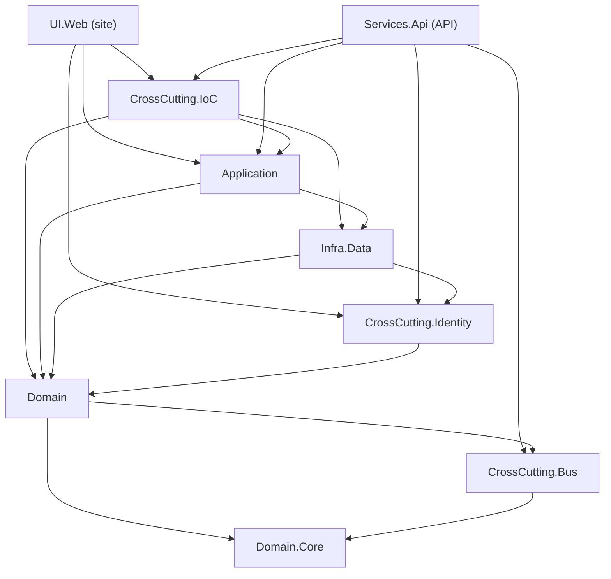

# Arquitetura do Equinox

Guia de uma página para quem chega hoje. Tudo aqui foi conferido no código em 26/10/2026; cada afirmação cita o arquivo (caminho a partir da raiz do repositório).

> **Versão do .NET:** todos os `.csproj` usam `<TargetFramework>net10.0</TargetFramework>` (ex.: `src/Equinox.UI.Web/Equinox.UI.Web.csproj:3`) e o CI instala `10.0.x` (`.github/workflows/dotnet-core.yml:19`). A migração a partir do .NET 9 está em `docs/migracao-net10.md`.

## Projetos da solution

As pastas de solução numeradas vêm de `Equinox.sln:5-18` e o encaixe de cada projeto nelas, de `Equinox.sln` (seção `NestedProjects`).

- **Equinox.UI.Web**: 1 - Presentation. Site MVC com Razor Pages do Identity; faz o CRUD de clientes pelo navegador.
- **Equinox.Services.Api**: 2 - Services. Web API REST com JWT e Swagger, expondo o mesmo CRUD.
- **Equinox.Application**: 3 - Application. `CustomerAppService`: converte ViewModel em comando e faz as consultas (`src/Equinox.Application/Services/CustomerAppService.cs`).
- **Equinox.Domain**: 4 - Domain. Entidade `Customer`, comandos, validações (FluentValidation), command handler e eventos.
- **Equinox.Domain.Core**: 4 - Domain. `IEventStore` e `StoredEvent`; traz o pacote NetDevPack (`src/Equinox.Domain.Core/Equinox.Domain.Core.csproj:7`).
- **Equinox.Infra.Data**: 5.1 - Data. EF Core: `EquinoxContext` (clientes), `EventStoreSqlContext` (eventos), repositórios e migrations.
- **Equinox.Infra.CrossCutting.Bus**: 5.2 - CrossCutting. `InMemoryBus`: envia comandos e publica eventos pelo mediator (`src/Equinox.Infra.CrossCutting.Bus/InMemoryBus.cs`).
- **Equinox.Infra.CrossCutting.Identity**: 5.2 - CrossCutting. ASP.NET Identity, JWT, autorização por claim e `EquinoxIdentityContext`.
- **Equinox.Infra.CrossCutting.IoC**: 5.2 - CrossCutting. Registra todos os serviços no DI (`src/Equinox.Infra.CrossCutting.IoC/NativeInjectorBootStrapper.cs`).
- **Equinox.Tests.Architecture**: 6 - Tests. 7 testes com NetArchTest; passaram em 26/10/2026 (`dotnet test`).

## Quem depende de quem

Setas = `<ProjectReference>` nos `.csproj` de cada projeto (`src/<Projeto>/<Projeto>.csproj`). O projeto de testes referencia todos os nove e foi omitido (`tests/Equinox.Tests.Architecture/Equinox.Tests.Architecture.csproj:26-36`).

O que surpreende quem espera DDD "de livro":

- **Application → Infra.Data:** `CustomerAppService` usa `IEventStoreRepository`, que fica no Infra.Data (`src/Equinox.Application/Services/CustomerAppService.cs:10`).
- **Infra.Data → Identity:** `SqlEventStore` usa `IAspNetUser` para gravar quem gerou o evento (`src/Equinox.Infra.Data/EventSourcing/SqlEventStore.cs:2,12`).
- **Domain → Domain.Core e Bus:** o Domain não é independente na compilação. Nenhum arquivo do Domain usa tipos de outro projeto `Equinox.*`, e por isso o teste "Domain Should Not Have Any Dependencies" passa (`tests/Equinox.Tests.Architecture/DomainTests.cs:9-31`). Mas as classes base (`Entity`, `Command`, `Event`, `CommandHandler`) vêm do NetDevPack, e o `.csproj` do Domain não declara esse pacote: ele chega por transitividade, pela referência ao Domain.Core (`src/Equinox.Domain/Equinox.Domain.csproj:7`, `src/Equinox.Domain.Core/Equinox.Domain.Core.csproj:7`). Testado numa cópia em 26/10/2026: sem a referência ao Bus (`Equinox.Domain.csproj:8`), o Domain compila; sem ela e sem a do Domain.Core, falha com `CS0246: 'NetDevPack' could not be found`.

## Pontos de entrada

**Site (`src/Equinox.UI.Web/Program.cs`)**

- Configura MVC, os DbContexts, o Identity Web e o DI (`Program.cs:7-10`). Pipeline: HTTPS → arquivos estáticos → roteamento → autenticação → autorização (`:27-31`). Rota padrão `Home/Index` mais as Razor Pages (`:33-34`).
- `UseDbSeed()` (`:37`) aplica as migrations dos três contextos e cria dados de exemplo, mas só nos ambientes `Development` ou `Docker` (`src/Equinox.UI.Web/Configurations/DbMigrationHelpers.cs:30-36`).
- **Banco:** em Development é SQLite, `Data Source=EquinoxProject.db` (`src/Equinox.UI.Web/Configurations/DatabaseConfig.cs:12-19`, `src/Equinox.UI.Web/appsettings.Development.json:3`). Fora dele é SQL Server `(localdb)` (`DatabaseConfig.cs:24-28`, `appsettings.Staging.json:3`).
- **Portas** (`src/Equinox.UI.Web/Properties/launchSettings.json`): `dotnet run` usa o perfil "Self Hosted", **https://localhost:61666** e http://localhost:61093 (`:35-43`). IIS Express usa http 10262 e SSL 44314 (`:5-8`). O Dockerfile expõe 80/443 (`src/Equinox.UI.Web/Dockerfile:5-6`).

**API (`src/Equinox.Services.Api/Program.cs`)**

- Configura controllers, os DbContexts, o Identity API com JWT, o Swagger e o DI (`Program.cs:8-12`). Pipeline: HTTPS → CORS liberado para qualquer origem, método e header → autenticação → autorização (`:17-25`).
- Mapeia os controllers (`:27`) e os endpoints prontos do Identity, `MapIdentityApi<IdentityUser>()` (`:28`), que o Swagger esconde (`src/Equinox.Services.Api/Configurations/SwaggerConfig.cs:49-77`). O Swagger fica ligado em qualquer ambiente, sem checagem de ambiente (`SwaggerConfig.cs:84-92`).
- **Banco:** sempre SQL Server para clientes e eventos (`src/Equinox.Services.Api/Configurations/DatabaseConfig.cs:12-16`), com `(localdb)` em Development (`src/Equinox.Services.Api/appsettings.Development.json:3`). A API não roda migrations nem seed.
- **Portas** (`src/Equinox.Services.Api/Properties/launchSettings.json`): "Self Hosted" usa **https://localhost:5001** e http://localhost:5000, e abre `/swagger` (`:36-44`). IIS Express usa http 59223 e SSL 44389 (`:5-8`).

## Fluxo do site (cadastro de um cliente até o banco)

1. O formulário `src/Equinox.UI.Web/Views/Customer/Create.cshtml:9` faz POST para `customer-management/register-new`.
2. `CustomerController.Create` exige login (`[Authorize]`) e a claim `Customers` com o valor `Write` (`src/Equinox.UI.Web/Controllers/CustomerController.cs:9,41-43`). O token antiforgery é validado por filtro global (`src/Equinox.UI.Web/Configurations/MvcConfig.cs:17-20`).
3. `CustomerAppService.Register` converte a ViewModel em `RegisterNewCustomerCommand` e chama `IMediatorHandler.SendCommand` (`src/Equinox.Application/Services/CustomerAppService.cs:34-38`).
4. `InMemoryBus.SendCommand` repassa ao mediator (`src/Equinox.Infra.CrossCutting.Bus/InMemoryBus.cs:23-26`), que resolve `CustomerCommandHandler` pelo DI (`NativeInjectorBootStrapper.cs:38`).
5. O handler valida com FluentValidation (`src/Equinox.Domain/Commands/RegisterNewCustomerCommand.cs:15-19`), recusa e-mail repetido, anexa o evento `CustomerRegisteredEvent`, chama `Add` e faz `Commit` (`src/Equinox.Domain/Commands/CustomerCommandHandler.cs:20-37`).
6. `EquinoxContext.Commit` publica os eventos de domínio **antes** do `SaveChangesAsync` (`src/Equinox.Infra.Data/Context/EquinoxContext.cs:41-56`). Cada evento passa por `InMemoryBus.PublishEvent` (`InMemoryBus.cs:15-21`), que:
   - grava o evento na tabela `StoredEvent` com um `SaveChanges` próprio do `EventStoreSqlContext` (`src/Equinox.Infra.Data/EventSourcing/SqlEventStore.cs:20-37`, `src/Equinox.Infra.Data/Repository/EventSourcing/EventStoreSQLRepository.cs:25-29`);
   - publica para `CustomerEventHandler`, que hoje não faz nada (`src/Equinox.Domain/Events/CustomerEventHandler.cs:19-24`).
7. `SaveChangesAsync` grava o cliente na tabela `Customers` (`src/Equinox.Infra.Data/Migrations/20250408031104_SQLite.cs:15`). Se houver erros de validação, eles voltam para o `ModelState` (`src/Equinox.UI.Web/Controllers/BaseController.cs:10-20`).

## Fluxo da API (requisição até o banco, com autenticação)

1. **Obter o token:** `POST /account/new` (cadastro) ou `POST /account/enter` (login com `PasswordSignInAsync`) (`src/Equinox.Services.Api/Controllers/AccountController.cs:27-29,55-61`).
2. O `JwtBuilder` monta o JWT com `sub`, `email`, as claims do usuário (`AspNetUserClaims`) e as roles, assinado com HMAC-SHA256 usando `AppSettings:SecretKey` (`src/Equinox.Infra.CrossCutting.Identity/API/JwtBuilder.cs:46-90`, `src/Equinox.Services.Api/appsettings.Development.json:13-18`).
3. **Chamar a API:** `POST /customer` com `Authorization: Bearer <token>`. `UseAuthentication` valida assinatura, issuer e audience (`src/Equinox.Infra.CrossCutting.Identity/Configuration/AspNetIdentityConfig.cs:79-104`).
4. `[CustomAuthorize("Customers", "Write")]` (`src/Equinox.Services.Api/Controllers/CustomerController.cs:34-35`) devolve 401 sem login e 403 sem a claim (`src/Equinox.Infra.CrossCutting.Identity/Authorization/RequerimentClaimFilter.cs:18-27`). O valor da claim é uma lista separada por vírgula (`src/Equinox.Infra.CrossCutting.Identity/Authorization/CustomAuthorizationValidation.cs:13`).
5. Daqui em diante o caminho é o mesmo do site, a partir do passo 3 (`CustomerController.cs:38` → `CustomerAppService.Register`).
6. A resposta é 200, ou 400 com `ValidationProblemDetails` em caso de erro (`src/Equinox.Services.Api/Controllers/ApiController.cs:12-23`).

Leituras (`GET /customer`, `GET /customer/{id}`, `GET /customer/history/{id}`) são anônimas (`CustomerController.cs:20-32,55-60`).

## Identity

- **Onde é configurado:** todo o registro de serviços (Identity, cookie, JWT, login social) está em `src/Equinox.Infra.CrossCutting.Identity/Configuration/AspNetIdentityConfig.cs`, chamado por `src/Equinox.UI.Web/Program.cs:9` e `src/Equinox.Services.Api/Program.cs:10`. Fora dele ficam só o middleware `UseAuthentication` e o `MapIdentityApi` (nos `Program.cs`), os valores de JWT e login social (nos `appsettings.*.json`) e o `IdentityHostingStartup.cs`, que está vazio.
  - Site: `AddWebIdentityConfiguration` (`:30-38`), com `AddIdentity` + `AddDefaultUI`, ou seja, login por cookie (`:69-77`), mais Facebook e Google (`:114-131`), cujas credenciais em `appsettings.*.json` são `SetYourDataHere`.
  - API: `AddApiIdentityConfiguration` (`:20-28`), com `AddIdentityApiEndpoints` + roles (`:57-67`) e JWT (`:79-104`).
- **Telas do site:** Login, Register e Logout estão em `src/Equinox.UI.Web/Areas/Identity/Pages/Account/`. As demais, como `/Account/Manage`, vêm do pacote Identity.UI (`AddDefaultUI`). O cadastro pelo site dá ao novo usuário só `Customers: Write`, sem `Remove` (`Register.cshtml.cs:75`).
- **Onde ficam os usuários:** `EquinoxIdentityContext : IdentityDbContext` (`src/Equinox.Infra.CrossCutting.Identity/Data/EquinoxIdentityContext.cs:10-13`), nas tabelas `AspNetUsers`, `AspNetUserClaims`, `AspNetRoles` etc. (`src/Equinox.Infra.CrossCutting.Identity/Migrations/20250408033115_SQLite.cs`). Usa a mesma `DefaultConnection` dos clientes; no site em Development, tudo fica no mesmo arquivo SQLite (`AspNetIdentityConfig.cs:40-55`).
- **Permissões:** são **claims**, não roles. Tipo `Customers`, valores `Write` e/ou `Remove`. O usuário de seed `teste@teste.com` recebe `Write,Remove` (`src/Equinox.UI.Web/Configurations/DbMigrationHelpers.cs:49-70`). As roles existem no schema e entram no JWT (`JwtBuilder.cs:67-73`), mas nenhum código verifica role: `AspNetUser.IsInRole` não tem chamadores.
- **Sobras de scaffolding:** `src/Equinox.UI.Web/Data/ApplicationDbContext.cs` e sua migration não são registrados em lugar nenhum, e `src/Equinox.UI.Web/Areas/Identity/IdentityHostingStartup.cs:8-9` está vazio.

## O que eu ainda não sei

Nada disto foi executado; são pontos que o código sozinho não fecha.

1. **API em Development:** o `EquinoxIdentityContext` usa `UseSqlite` em Development (`AspNetIdentityConfig.cs:42-46`), mas a connection string da API é de SQL Server (`appsettings.Development.json:3`). Pela leitura, login e cadastro na API falhariam nesse ambiente; não subi a API para confirmar.
2. **Esquema de autenticação padrão da API:** `AddIdentityApiEndpoints` registra um bearer próprio do Identity, e depois `AddJwtBearer` define o JWT como padrão (`AspNetIdentityConfig.cs:22-24`). Espero que o JWT vença e que os tokens de `/login` do `MapIdentityApi` não passem no `CustomerController`, mas não testei.
3. **Como o banco SQL Server é criado:** só o site migra, e só em Development/Docker. As migrations do repositório foram geradas para SQLite (nomes `*_SQLite`). Não sei se aplicam em SQL Server ou se a ideia é usar `sql/GenerateDataBase.sql` (script de 2016, em UTF-16).
4. **Ordem evento × cliente:** o evento é gravado num `SaveChanges` separado, antes do cliente (passo 6 do fluxo do site). Se a gravação do cliente falhar, o evento parece ficar órfão. O `Commit` do `CommandHandler` vem do pacote NetDevPack e não li o código dele.
5. **Docker:** os Dockerfiles usam imagens `aspnet:10.0`/`sdk:10.0`, mas ainda expõem as portas 80/443 (o padrão das imagens é 8080 desde o .NET 8). O do site copia `Equinox.UI.Web/...` com contexto na raiz do repositório (`DockerfileContext ..\..`). Não há `docker-compose` nem `appsettings.Docker.json`, embora o seed cite o ambiente `Docker`. Não tentei construir.
6. **Produção:** nenhum `appsettings.json` traz connection string nem `AppSettings` de JWT. Imagino que venham de variáveis de ambiente (`MvcConfig.cs:15`, `ApiConfig.cs:13`), mas não sei de onde.
7. **Senha do usuário de seed:** o código só tem o hash (`DbMigrationHelpers.cs:58`).
8. **Por que o Domain referencia o Bus:** a referência não é necessária para compilar (ver "Quem depende de quem"); não sei se é intencional.
